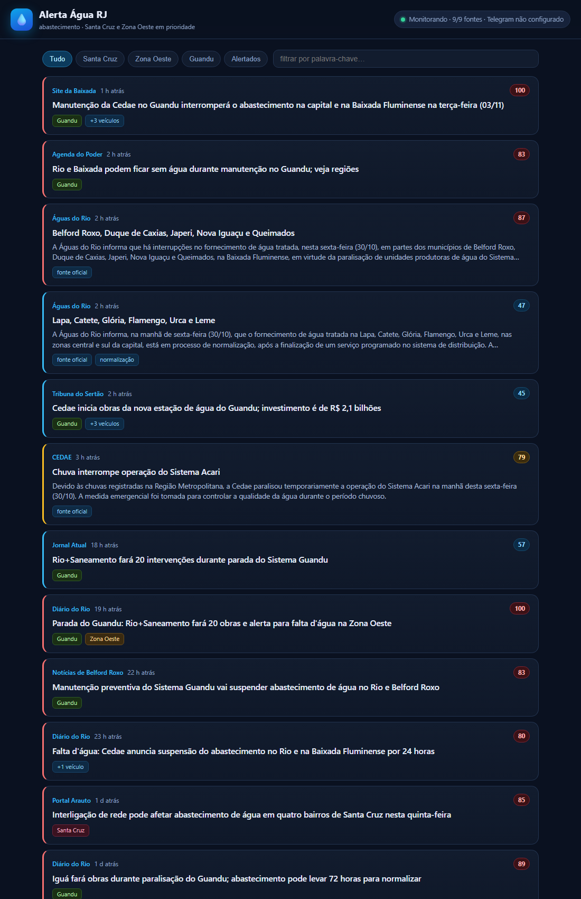

# Alerta Água RJ 💧

Monitora notícias sobre abastecimento de água no Rio de Janeiro e manda um
alerta no Telegram assim que algo relevante é publicado — com prioridade para
**Santa Cruz** e a **Zona Oeste**.

Feito para rodar no seu PC, sem instalar nada além do Python (usa só a
biblioteca padrão) e sem chave de API paga.



> **Primeira vez?** O [GUIA.md](GUIA.md) tem o passo a passo completo, do
> @BotFather até o painel no ar. Leva uns 10 minutos.

---

## Como funciona

A cada **2 minutos** o app consulta:

| Fonte | O que é |
|---|---|
| **Águas do Rio** | feed RSS oficial do site da concessionária |
| **CEDAE** | lista de notícias do site oficial |
| **Google News** | 7 buscas (Santa Cruz, Zona Oeste, Guandu, Cedae, racionamento…) |

Cada notícia passa por um filtro:

1. **É sobre água?** (abastecimento, falta d'água, adutora, manutenção, Guandu…)
2. **É no Rio?** (capital, bairros, Baixada, Guandu). Notícia da CEDAE em
   Barra do Piraí ou Italva é descartada.
3. **Nota de 0 a 100**, somando sinais: Santa Cruz (+38), Guandu (+22),
   Zona Oeste (+16), impacto imediato (+20), fonte oficial (+12)…

**Telegram** recebe só o que é prioritário *e* tira nota ≥ 60. O resto aparece
no painel. Notícias do mesmo fato em veículos diferentes são agrupadas
("+3 veículos") e não geram alertas repetidos.

---

## Instalação (uma vez)

### 1. Crie o bot no Telegram

1. Abra o Telegram e procure **@BotFather**
2. Envie `/newbot`, escolha um nome (ex.: `Alerta Agua Santa Cruz`) e um
   usuário terminado em `bot`
3. Copie o **token** que ele devolve (algo como `123456789:AAH...`)

### 2. Configure

Dê dois cliques em **`configurar.bat`** (ou rode `python setup.py`).

Ele valida o token, pede para você mandar um "oi" para o bot, descobre seu
chat automaticamente e envia uma mensagem de teste.

### 3. Ligue o monitor

Dê dois cliques em **`run.bat`**. Vai aparecer:

```
Alerta Água RJ está no ar
Painel: http://127.0.0.1:8765
```

Abra o painel no navegador. Deixe essa janela aberta — é ela que fica vigiando.

---

## Uso no dia a dia

- **Painel** (`http://127.0.0.1:8765`): linha do tempo com filtros por Santa
  Cruz, Zona Oeste, Guandu e "alertados". Atualiza sozinho a cada 60 s.
- **Telegram**: mensagem com título, veículo, horário, bairros afetados e link.
- **Sem barulho**: na primeira execução ele manda um resumo do que já está no
  ar, em vez de despejar dezenas de alertas antigos.

### Deixar rodando sozinho

Rode **`iniciar_com_windows.bat`** uma vez: ele cria um atalho na pasta de
inicialização do Windows. A partir daí o monitor sobe junto com o sistema.

Para desfazer, apague o atalho:
`%APPDATA%\Microsoft\Windows\Start Menu\Programs\Startup\Alerta Agua RJ.lnk`

---

## Rodar na nuvem de graça

Dá para manter o monitor no ar com o PC desligado. Só existem dois caminhos
realmente gratuitos hoje — e eles trocam velocidade por simplicidade:

| Opção | Custo | Atraso típico | Painel | Tempo de montagem |
|---|---|---|---|---|
| **GitHub Actions + Pages** | R$ 0 (repo público) | 10–20 min | sim | ~15 min |
| **Oracle Cloud Always Free** | R$ 0 | 2 min | sim | ~40 min |
| Google Cloud e2-micro | R$ 0* | 2 min | sim | ~40 min |

\* exige cartão de crédito para verificação (sem cobrança no tier gratuito).

> Heroku, Railway, Render, Fly.io e PythonAnywhere **não** servem mais para isso:
> ou acabou o tier grátis, ou cobram por cron job, ou desligam por inatividade.

### Opção A — GitHub Actions + GitHub Pages (sem servidor)

O workflow já está pronto em `.github/workflows/monitor.yml`. A cada 10 minutos
ele roda `python app.py --once`, manda os alertas no Telegram e regenera o
painel estático em `docs/index.html`, que o GitHub Pages publica.

> **Atalho no Windows:** o `publicar.ps1` faz os passos 1 a 5 sozinho. Ele
> instala Git e GitHub CLI pelo winget, pede o login no navegador, cria o
> repositório público, grava os secrets e liga o Pages.
>
> ```powershell
> powershell -ExecutionPolicy Bypass -File .\publicar.ps1
> ```
>
> Ele pede só o token do bot e descobre o seu chat id quando você manda "oi"
> para o bot. Para ver o que ele faria antes: `-Simular`.

Passo a passo manual:

1. Crie um repositório **público** no GitHub e suba a pasta do projeto:
   ```bash
   cd alerta-agua-rio
   git init && git add . && git commit -m "Alerta Água RJ"
   git branch -M main
   git remote add origin https://github.com/SEU-USUARIO/alerta-agua-rio.git
   git push -u origin main
   ```
   Use repositório **público**: no privado, 144 execuções por dia estouram os
   2.000 minutos grátis do mês. Seus segredos ficam em Secrets, não no código.

2. No repositório: **Settings → Secrets and variables → Actions →
   New repository secret**, e crie dois:
   - `TELEGRAM_BOT_TOKEN` — o token do @BotFather
   - `TELEGRAM_CHAT_ID` — o mesmo número que o `setup.py` descobriu
     (se não anotou: rode `python setup.py` localmente e veja o `config.json`)

3. Ainda em **Settings → Pages**: em *Source* escolha **Deploy from a branch**,
   branch **main** e pasta **/docs**. Salve.
   Seu painel fica em `https://SEU-USUARIO.github.io/alerta-agua-rio/`.

4. Aba **Actions** → aceite habilitar os workflows → escolha
   **Monitor de abastecimento** → **Run workflow** para testar na hora.

5. Confira a mensagem no Telegram e o painel no endereço do Pages.

**O que saber antes:**

- O cron do GitHub é *best-effort*: atrasa com frequência e pode pular uma
  janela. Na prática, o aviso chega **10 a 20 minutos** depois da publicação.
- O painel é uma **foto** atualizada quando chega notícia nova — ele não
  recarrega sozinho nem mostra "ao vivo". Se não houver notícia, o commit (e a
  atualização da página) não acontece.
- Para tentar mais rápido, troque `"*/10 * * * *"` por `"*/5 * * * *"` no
  workflow — mas o GitHub costuma atrasar mesmo assim.
- Workflows agendados são desativados após **60 dias sem atividade** no
  repositório. Os commits do próprio bot contam como atividade; se parar,
  basta reativar na aba Actions.
- Cada execução faz ~9 requisições. Se o Google começar a bloquear, aumente o
  intervalo ou remova buscas em `coleta.queries`.

### Opção B — Oracle Cloud Always Free (24/7 de verdade)

Melhor opção se você quer o painel e a checagem de 2 em 2 minutos. A conta
"Always Free" não expira e não cobra, mas pede cartão só para validar.

1. Crie a conta em [cloud.oracle.com/free](https://www.oracle.com/br/cloud/free/)
   e escolha a região mais próxima (São Paulo ou Vinhedo).
2. **Compute → Instances → Create instance**:
   - Imagem: **Ubuntu 22.04**
   - Shape: **VM.Standard.A1.Flex** (ARM), 1 OCPU / 6 GB — dentro do grátis
   - Baixe a chave SSH privada
3. Conecte e prepare:
   ```bash
   ssh -i chave.key ubuntu@SEU-IP
   sudo apt update && sudo apt install -y python3 git
   sudo git clone https://github.com/SEU-USUARIO/alerta-agua-rio.git /opt/alerta-agua-rio
   ```
4. Configure o Telegram na máquina:
   ```bash
   cd /opt/alerta-agua-rio && python3 setup.py
   ```
5. Instale como serviço (sobe sozinho e reinicia se cair):
   ```bash
   sudo cp deploy/alerta-agua.service /etc/systemd/system/
   sudo systemctl daemon-reload
   sudo systemctl enable --now alerta-agua
   sudo systemctl status alerta-agua
   ```
6. Veja os logs: `journalctl -u alerta-agua -f`

**Para abrir o painel** sem expor nada na internet, use um túnel SSH:

```bash
ssh -i chave.key -L 8765:localhost:8765 ubuntu@SEU-IP
```

e acesse `http://localhost:8765` no seu PC.

> A Oracle às vezes fica sem capacidade para a instância ARM na sua região
> ("out of capacity"). Nesse caso tente outra região/zona, ou use a instância
> `VM.Standard.E2.1.Micro` (AMD, também gratuita, mais lenta).

### Opção C — Google Cloud e2-micro

Parecido com a Oracle: uma VM `e2-micro` em `us-central1`, `us-west1` ou
`us-east1` fica de graça para sempre (30 GB de disco). Exige conta de
faturamento ativa, mas o tier gratuito não gera cobrança. Os passos são os
mesmos da Opção B a partir do item 3.

---

## Configuração (`config.json`)

Criado automaticamente. Os campos que importam:

| Campo | Padrão | Para que serve |
|---|---|---|
| `coleta.intervalo_segundos` | `120` | Frequência das checagens |
| `coleta.queries` | 7 buscas | Ajuste as buscas do Google News |
| `coleta.janela_queries` | `"7d"` | Janela temporal das buscas (`when:7d`) |
| `coleta.idade_maxima_dias` | `14` | Notícia mais velha que isso é ignorada |
| `pontuacao.minimo_painel` | `45` | Nota mínima para aparecer no painel |
| `pontuacao.minimo_alerta` | `60` | Nota mínima para tocar no Telegram |
| `alertas.max_por_ciclo` | `4` | Teto de mensagens por checagem |
| `alertas.janela_cluster_horas` | `12` | Janela para não repetir o mesmo fato |
| `web.porta` | `8765` | Porta do painel |

Exemplo: para receber **tudo** do Rio no Telegram, baixe `minimo_alerta` para
`45`. Para só o essencial, suba para `75`.

---

## Comandos

```bat
run.bat                     REM monitor + painel
python app.py --once        REM roda uma checagem e mostra o relatório
python app.py --once --dry-run   REM simula sem enviar nada
python app.py --testar-telegram  REM testa a mensagem
python app.py --exportar-html docs/index.html   REM gera o painel estático
python setup.py             REM reconfigura o Telegram
```

Para rodar sem `config.json` (nuvem, contêiner, CI), use variáveis de ambiente:

| Variável | Equivale a |
|---|---|
| `TELEGRAM_BOT_TOKEN` | `telegram.bot_token` |
| `TELEGRAM_CHAT_ID` | `telegram.chat_id` |
| `AGUA_DB_PATH` | caminho do banco (padrão `data/agua.db`) |
| `AGUA_INTERVALO` | `coleta.intervalo_segundos` |
| `AGUA_PORTA` | `web.porta` |

Testes da pontuação (não precisam de internet):

```bat
python -m unittest discover -s tests -v
```

---

## Limitações (o que este app não faz)

- **Não é tempo real absoluto.** A notícia é detectada entre **1 e 10 minutos**
  depois de publicada. Não existe API oficial instantânea da concessionária.
- **Depende do Google News** para a maior parte da cobertura. Se o Google mudar
  o RSS, a fonte cai (o app continua com as fontes oficiais e avisa no painel).
- **Só o que é publicado.** Falta d'água sem notícia não aparece.
- O painel fica em `127.0.0.1` (só no seu PC). Para abrir no celular na mesma
  rede, troque `web.host` para `0.0.0.0` no `config.json`.
- Respeite o uso pessoal: o app faz ~7 requisições a cada 2 minutos.

---

## Estrutura

```
alerta-agua-rio/
├─ app.py                 ponto de entrada / CLI
├─ setup.py               assistente do Telegram
├─ run.bat                inicia o monitor
├─ configurar.bat         atalho para o setup.py
├─ iniciar_com_windows.bat  cria atalho de inicialização
├─ publicar.ps1           publica no GitHub (repo, secrets e Pages)
├─ GUIA.md                passo a passo da instalação
├─ config.example.json    modelo de configuração
├─ .github/workflows/monitor.yml  execução gratuita no GitHub Actions
├─ deploy/alerta-agua.service     serviço systemd para VPS (Oracle/GCP)
├─ docs/index.html        painel estático gerado (publicado pelo Pages)
├─ docs/painel.png        print do painel
├─ agua/
│  ├─ sources.py          coleta (RSS e HTML) das fontes
│  ├─ scoring.py          filtro e pontuação de relevância
│  ├─ monitor.py          ciclo: coleta → pontua → alerta
│  ├─ store.py            SQLite (histórico e deduplicação)
│  ├─ telegram.py         envio de mensagens
│  ├─ dedupe.py           agrupa o mesmo fato em vários veículos
│  ├─ exportar.py         gera o painel estático para o Pages
│  ├─ web.py              servidor do painel local
│  └─ dashboard.html      interface (serve local e estático)
├─ data/agua.db           banco (criado na primeira execução)
├─ logs/alerta.log        registro de execução
└─ tests/test_scoring.py  testes da pontuação
```
